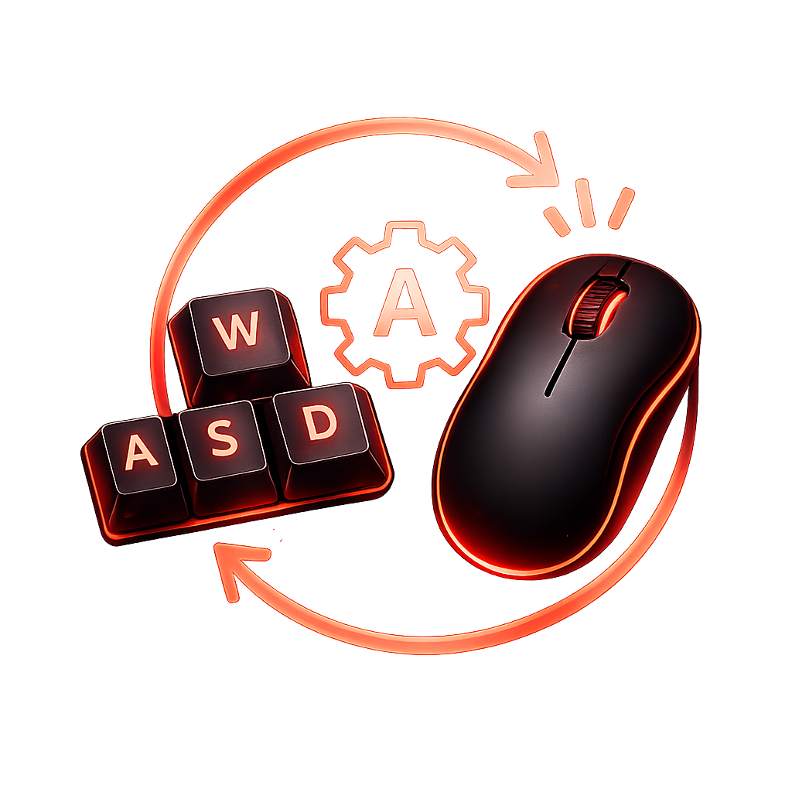

# Cachy AutoClicker

A native C++ Qt6 auto-clicker and key-holder utility designed specifically to bypass security restrictions on modern Wayland sessions (like CachyOS, Arch Linux, or Fedora) using the Linux kernel `uinput` architecture.

<p align="left">
  
</p>

[](#)
[](#)
[](#)
[](#)

---

## ⚠️ CRITICAL: Hardware Permission Requirements

Because this application interacts directly with kernel-level device emulation (`/dev/uinput`) to generate native keystrokes/clicks and interfaces directly with `/dev/input/` events to track your global hotkey, **it requires elevated system hardware privileges.** If launched without these permissions, the graphical window will load normally, but the background engine and hotkey toggles will remain completely unresponsive.

---

## 🚀 How to Run the Pre-compiled Release Binary

### 1. Download & Prepare the Binary

1. Go to the **Releases** tab on the right side of this GitHub repository page.
2. Download the compiled standalone `CachyAutoClicker` binary.
3. Make sure the **Qt 6 runtime** is installed (on Arch/CachyOS: `sudo pacman -S qt6-base`; the binary is dynamically linked).
4. Open a terminal where you downloaded the file and mark it as executable:
   ```bash
   chmod +x CachyAutoClicker
   ```

### 2. Run the Application

Because this application interfaces directly with `/dev/uinput` and `/dev/input`, it **must have permission to access input hardware**. You have two supported execution paths:

---

#### 🔹 Method A — Run with Root Privileges (Quickest)

This method guarantees immediate functionality by running the binary as root:

```bash
sudo ./CachyAutoClicker
```

- ✅ No setup required
- ✅ Works instantly
- ❌ Requires entering your password every launch
- ❌ Runs entire GUI as root (not ideal long-term)

---

#### 🔹 Method B — Persistent User-Space Access (Recommended)

This method configures your system so your **normal user can access input hardware directly**, allowing you to run the app without `sudo`.

##### Step 1 — Create uinput udev Rule

```bash
echo 'KERNEL=="uinput", GROUP="input", MODE="0660"' | sudo tee /etc/udev/rules.d/99-uinput.rules
```

##### Step 2 — Reload udev Rules

```bash
sudo udevadm control --reload-rules && sudo udevadm trigger
```

##### Step 3 — Add Your User to the Input Group

```bash
sudo usermod -aG input $USER
```

##### Step 4 — Apply Group Changes

You **must** log out and back in (or reboot):

```bash
reboot
```

---

##### ✅ After Setup

You can now run the application normally:

```bash
./CachyAutoClicker
```

- ✅ No sudo required
- ✅ Proper long-term solution
- ✅ Safer than running full GUI as root

---

### ⚠️ Troubleshooting

If the application launches but inputs or hotkeys do not work:

- Ensure you completed **Step 4 (reboot/log out)**
- Verify group membership:

  ```bash
  groups
  ```

  You should see `input` listed

- Confirm uinput rule exists:

  ```bash
  ls /etc/udev/rules.d/99-uinput.rules
  ```

---

### 💡 Recommendation

Use **Method A** for quick testing, but switch to **Method B** for daily use. It provides proper access control without elevating the entire application to root.

---

## 🎹 Toggle hotkey

The toggle key defaults to **F6** and can be changed in the app: click the hotkey button, then press the key you want. The choice is remembered between launches.

### Keyboards forwarded by Deskflow, Synergy or Input Leap

On Wayland those tools inject your keys into the compositor (through libei), so they never show up as devices in `/dev/input`, which is where the hotkey is read from. A key typed on the forwarded keyboard reaches the focused window but not that reader.

So the app also registers its hotkey with your desktop through the XDG GlobalShortcuts portal, which does see those keys (tested on KDE Plasma 6 with Deskflow):

- **First launch:** your desktop shows a one-time confirmation dialog for the shortcut. Approve it and the toggle key works from any keyboard. It appears in **System Settings > Shortcuts** as "Cachy AutoClicker".
- **Changing the key** in the app silently moves the desktop's binding too (KDE). On other desktops change it in the desktop's own shortcut settings.
- The portal needs an app id, so the app writes a launcher entry, `~/.local/share/applications/org.glitxh.CachyAutoClicker.desktop` (and an icon in `~/.local/share/CachyAutoClicker/`). Delete them to remove it.

| Session | Hotkey from a forwarded keyboard | Alt+Tab pause for a forwarded keyboard |
| --- | --- | --- |
| KDE Plasma (Wayland) | desktop portal (tested) | KDE's switcher signals (tested) |
| X11 (GNOME, XFCE, Cinnamon, i3, KDE...) | X11 key grab (tested against a nested X server with XTest input, which is how Deskflow injects on X11) | X11 key state (tested the same way) |
| GNOME / Hyprland (Wayland) | desktop portal (should work, **untested**; Hyprland needs one `bind = , F6, global, org.glitxh.CachyAutoClicker:toggle` line in `hyprland.conf`) | physical keyboards only |
| Sway, niri | `--toggle` command below | not needed: they switch windows instantly |

On X11 sessions the app grabs the key through X instead of using the portal. Building X11 support needs the libX11 headers (`libx11` on Arch/CachyOS); without them the app still builds and everything else works.

Desktops without a GlobalShortcuts portal (Sway, niri) can instead bind a key in their own config to a command that talks to the running app:

```bash
CachyAutoClicker --toggle      # start if stopped, stop if running
CachyAutoClicker --start       # --stop is the opposite
CachyAutoClicker --status      # prints "running" or "stopped"; exit code 0 = running, 1 = stopped, 2 = app not running
```

When more than one path fires for the same key press (a physical keyboard is seen by both the `/dev/input` reader and the portal), toggles within about 0.8 seconds of each other count as one.

### Alt+Tab

While Alt is held the clicker stops sending input and releases anything it was holding, then waits about 0.4 seconds before resuming. Otherwise it would click or press keys through a window switcher, which on KDE doesn't change the focused window until you let go of Alt. Alt is read from the keyboards the app can see in `/dev/input`; on KDE it also listens for KWin's own window-switcher shortcut, and on X11 it asks the X server, so Alt+Tab from a Deskflow-forwarded keyboard is covered too.

Building needs the Qt6 `Widgets`, `DBus` and `Network` modules (on Arch/CachyOS the `qt6-base` package has all three).

